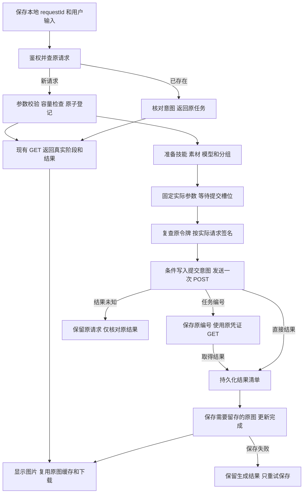

# 图片生成优化方案：基于当前项目重新制定

基线：`main` 的 `4ae740b`。本方案的第一、二批已实现并通过本地验证，不沿用旧分支的存储结构或执行授权实现。

## 目标

让用户看清当前处理阶段，在负载升高时有序提交；同一请求始终找回原任务，保存出错可以单独恢复。复用现有请求、账号、协议和媒体能力，避免同时重写提交、查询、缓存和账务。

首期接受一项明确取舍：进程异常退出后，尚未提交的请求显示“未提交”，由用户确认后发起新请求；已写提交意图但结果未知的请求继续保留原编号，不能自动重发。首期不承诺重启后离线自动提交。

## 1. 现有能力与实际缺口

| 环节 | 当前代码已具备 | 本次需要补齐 |
| --- | --- | --- |
| 请求受理 | 同一 requestId；PostgreSQL 主键屏障；v2/group；原账号与分组凭证验证 | 规范化指纹；重复请求不占新增任务配额；受理前背压 |
| 提交防重 | owner/version 条件更新；发送前持久化 dispatch_intent | 单独限制初次图片 POST；短队列在签名前等待 |
| 执行恢复 | 原上游编号与密封 GET 凭证；后台查询、退避；准备过期后禁止原执行者继续提交 | 明确区分未提交、正在生成、结果待确认，避免把所有异常都引导为重新生成 |
| 结果保存 | 请求记录写入重试；大 JSON 与请求文件兜底 | 外部临时结果的原图留存；保存步骤独立恢复；已保存图片不重复下载 |
| 前端展示 | 原请求查询；四个并发 GET；账号切换取消；原图缓存、预览与下载复用 | 准备、等待提交、生成、保存的可信阶段，以及对应恢复按钮 |
| 服务退出 | 停止受理、跟踪已接受工作、等待结果持久化后关闭连接 | 保留并扩展故障测试，不再另建一套退出控制 |

当前主要依据：`server/creation.ts`、`server/creation/request-store.ts`、`server/creation/inflight.ts`、`src/native-studio.ts`、`server/creation/image-preview.ts`。

## 2. 新流程

这是现有链路的增量调整。保留 `/api/creation/generate`、`/api/creation/requests/:id`、原 requestId 以及上游 Idempotency-Key。不创建第二套请求身份，不替换现有请求表。

## 3. 首期改动

### 3.1 稳定意图与固定执行参数

在现有 `requestFingerprint` 中规范化对象键顺序，数组顺序保持不变。指纹保留用户原始模型、group、显式 token、Auto 选择、参数及素材引用；服务端解析后的配置另存执行快照，不能参与恢复时的重新解释。

读取时兼容历史指纹，新规范只用于新请求。重复查同一请求先执行意图和归属校验，再进入新增任务限流；相同请求不再占新的提交槽位。

技能提示词、参考素材数量限制、Gemini 历史图片、Auto 配置和 v2/group 全部沿用当前准备顺序。在现有 context 补必要的已解析参数和素材引用；大图片不写入数据库，也不持久化登录 Cookie。准备好的字节供当前执行使用，需要暂存时复用 FILES_ROOT。

### 3.2 受控提交，而非完整离线执行框架

为图片初次 POST 增加独立的有界短队列。排队位置在请求签名前；取得槽位后重新检查原执行身份，再签名、执行原有 dispatch_intent 条件更新并发送。

可从单进程 2 个图片 POST 开始实测，沿用现有 4 个 GET 的读取控制。提交与 GET、保存分别安排执行容量，长时间生成不能耗尽取结果的资源。多进程时必须明确限制是进程级还是全局级，不能把本地计数当全局配额。

等待超过短队列期限或容量不足时，明确返回“未提交”，并给出重试时间；期限初值可设 30 秒后按实测调整。已受理的同编号重复请求仍可读取。准备失败、准备过期和退出时的处理继续使用现有 owner/version 防护。

首期不新增密封 POST 授权、重新授权接口或独立图片队列表。若以后明确要求“重启后用户离线仍能继续提交”，再设计最小执行授权、不可变素材与可恢复领取，不能用保存通用登录会话替代。

### 3.3 阶段可见，不增加一套业务状态

保留当前业务 status。在 `record.result` 中增加展示用途的 stage 和阶段时间戳：preparing、queued、generating、saving。stage 由实际步骤更新，进度百分比只使用上游真实进度。

任务登记后，即使第一次提交响应仍在准备，前端也能用已有 requestId 查询阶段。优先复用现有四并发 GET、限流退避与账号取消逻辑，避免另写轮询器。

先用分阶段、有退避的 GET 验证体验；当前任务较频繁更新，历史任务降低频率。页面离开只暂停本页等待，不把它显示成供应商取消。

首期不新增 SSE。只有在阶段与恢复正确之后，再决定是否为当前选中的一条任务增加订阅；届时继续复用现有解析器，并保留 GET 补齐。

### 3.4 生成完成与保存完成分开处理

先可靠保存上游结果清单，再保存需要留存的原图。沿用现有结果落库重试与文件兜底，不新增多套等价回执。

原图留存按来源能力决定：已经由社区控制并有明确留存保障的文件复用引用；无保障的远程或临时结果转存。来源能力要显式配置和验证，不能仅凭域名或 URL 后缀推断永久有效。

保存必须保持原始字节，预览单独生成。按原账号和请求读取，继续经过现有媒体类型、大小和网络限制。成功状态所引用的图片必须已达到承诺的留存条件。

保存失败时保留上游成功证据，显示“图片已生成，保存未完成”，提供只重试保存的入口。多图任务记录每张图片的保存进度，重试只处理缺失项。数据库或文件关联失败时修复引用，不重新生成。

浏览器缓存和本地下载继续使用当前实现。浏览器配额不足只影响本地保存提示，不把服务端生成成功改成失败。

## 4. 恢复动作

| 当前情况 | 用户可见动作 | 服务端执行 |
| --- | --- | --- |
| 参数或准备明确失败，未提交 | 修改后重新生成 | 新 requestId，原记录保留 |
| 提交中断，结果未知 | 查询原结果 | 原 requestId；只核对，不重发生成 POST |
| 已有上游任务编号 | 继续查看 | 原账号、原编号 GET |
| 已取得结果，保存失败 | 重试保存 | 修复下载、文件或数据库关联 |
| 页面关闭或用户停止等待 | 继续查看 | 恢复原请求查询 |
| 账号切换 | 返回原账号查看 | 不借用新账号凭证 |

接口错误、等待超时、用户停止等待不作为“未扣费”或“已退款”的依据。继续由现有网关承担计费，不新增社区账务副本。

## 5. 实施顺序与验收

第一批：稳定指纹与旧记录兼容；可信阶段；初次 POST 并发和短队列；保留现有身份、素材、协议及退出控制。

第二批：结果清单持久化顺序、外部临时原图留存、逐图保存进度与独立重试；复用前端原图缓存和下载。

后续按测量决定：当前任务 SSE、跨进程共享容量限制、完整离线队列。首期不一并引入。

验收以行为为准：

1. 并发提交相同 requestId 只有一次上游 POST；只改变 JSON 键顺序仍返回原任务；改变意图明确冲突。
2. 排队期间能看到可信阶段；等待不占用 GET 结果恢复容量；排队后的签名按实际发送请求生成。
3. v2/group、技能、参考素材限制、Gemini 多轮及同步/异步图片协议不回退。
4. 请求发送后断网或进程异常退出，不自动再发生成；异常退出前尚未提交的任务能明确显示未提交。
5. 图片保存或数据库关联故障，只重试对应步骤；多图已保存部分不重复下载，POST 次数不增加。
6. 原图哈希保持一致；预览、浏览器缓存与下载故障分别提示；跨账号不能读取私有结果。
7. 退出时停止新受理并等待已接受工作保存，继续通过当前退出回归。

记录准备耗时、排队耗时、供应商等待耗时、结果保存耗时、原图重复下载次数和未知结果比例。以这些数据决定后续优化，不预先承诺固定提速。

## 6. 本次实现与验证

继续使用现有 `community_creation_request` 和 owner/version 条件更新，无需新建表或替换既有迁移。新规范化指纹兼容原有指纹，历史任务不重新提交。

`image-submissions.ts` 将单进程图片初次 POST 限制为 2 个，总预留名额 10 个、同账号 2 个，真正等待提交超过 30 秒返回明确的未提交错误。等待后用新的 AccountRequest 重新检查原令牌和账号，避开原请求级权限缓存。保存和 GET 不占 POST 槽。

现有 `record.result` 保存阶段及开始时间，记录中另存受理、排队、提交、取得结果和保存完成时间。图片 POST 等待超过 2 秒时，前端开始通过原有四槽 GET 监视阶段；POST 结束、停止等待或切换账号时自动结束监视。不增加新的 SSE。

启用现有 `COMMUNITY_REQUEST_STORE=1` 时，新图片请求先持久化结果，再将外部图片原始字节保存到 FILES_ROOT。无法证明外部长期留存保障的来源默认转存；已持久化的请求按逐图检查点复用。旧记录和关闭持久功能的旧链路保持原有读取方式。

新增 `/api/creation/requests/:id/save` 只恢复原图保存，不提交生成。私有原图沿用 `/api/creation/media`，使用当前账号、requestId 和 index 定位；预览复用现有图片读取控制。整体保存截止为 90 秒，数据库维护间隔为 120 秒；保存失败保留原始结果，成功部分不重复下载。大 JSON 和恢复文件先完整写入、同步并原子发布，避免覆盖中断损坏恢复源。

本地验证：前端全量 615 项通过；服务端全量 881 项通过、20 项因未配置其他模块的真实 PostgreSQL/Redis 环境而跳过、0 失败；桌面 1440px / 手机 390px 浏览器 6 项通过；构建通过。新增保存模块的 11 项测试包含整体截止、阻塞上游取消、检查点恢复、原图哈希与读取隔离；提交队列 7 项测试覆盖容量、FIFO、取消和超时。

本次未执行真实付费生成或生产部署。并发额度仅限单个 Web 进程；私有图片和内容寻址的大结果文件尚无自动清理策略，应配置持久卷并纳入容量管理。真实供应商留存与账务行为不由模拟测试证明。
